# LCARS Stardate

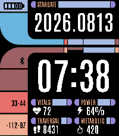 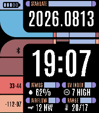 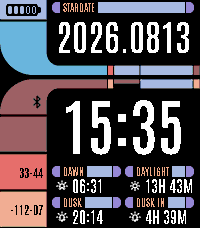 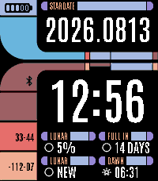 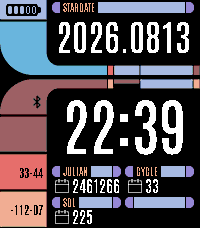 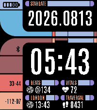

An LCARS watchface for the Pebble Time 2. The time sits inside a *Star Trek* computer frame, with four ops panels below it for the readouts you pick.

## Features

- The time in 12-hour, 24-hour, or Swatch Internet Time (.beats), and a stardate-style date on the STARDATE banner.
- Four ops panels, filled by dragging readouts onto a picture of the face.
- Readouts for your health, the battery, the sun, the moon, the weather, day counts, .beats, the Unix time, a second time zone, and your next alarm.
- Your coordinates, a bluetooth glyph, and an optional Quiet Time glyph on the left rail, and a battery gauge in the top corner.
- Nine frame themes, with an optional swap after dark or during Quiet Time.
- Optional buzzes on the hour and when the phone connects or drops.

## Installation

1. **Install LCARS Stardate.** Download `lcars-stardate-emery-<version>.pbw` from [Releases](https://github.com/AKlitbo/pebble-watchface-lcars/releases) and open it with the Pebble app on your phone. It runs on the Pebble Time 2 (Emery) only, with watch firmware 4.44.3 or later.
2. **Allow Its Permissions** when the Pebble app asks, as [Permissions](#permissions) covers.
3. **Set Up the Weather.** Enable Phone GPS is off on a new install, so pick a Manual Location or turn GPS on.
4. **Turn Plugins On** to use a weather plugin. In the Pebble app, go to Settings, Plugins, and turn on Plugins / permissions preview, then pick Pebble App: Preferred Source as the Data Source. Everything else works with plugins off.
5. **Pick Your Readouts** under Ops Panels on the settings page.

## Configuration

Open LCARS Stardate's settings in the Pebble app.

### Appearance

| Setting | What It Does |
| :-- | :-- |
| Frame Theme | The frame's colour scheme, from nine. Classic by default. |
| Theme Mode | Fixed, the default, keeps the Frame Theme. Day / Night / Quiet can swap in another after dark or during Quiet Time. |
| Use Night Theme and Night Theme | Wears the Night Theme from sunset to sunrise. Off by default. |
| Use Quiet Time Theme and Quiet Time Theme | Wears the Quiet Time Theme during Quiet Time, even at night. Off by default. |
| Show Quiet Time Icon | A muted speaker on the left rail during Quiet Time. Off by default. |

### Ops Panels

| Setting | What It Does |
| :-- | :-- |
| The Panel Builder | Drag a readout onto a panel, or one panel onto another to swap them. Default puts back the Sensors Block, Heart Rate, and Steps / Distance. Clear empties all four. |

### Bluetooth

| Setting | What It Does |
| :-- | :-- |
| Show Connection Icon | The bluetooth glyph on the left rail, slashed when the phone drops. On by default. |
| Vibrate on Connect and Vibrate on Disconnect | A Short, Long, or Double buzz when the phone reconnects or drops. None by default. |

### Clock

| Setting | What It Does |
| :-- | :-- |
| Date Format | How the banner writes the date, such as 2026.0618, the default, or THU 18 JUN. The .beat formats add .beats to the date. |
| Time Format | System Default, the default, 12-hour, 24-hour, or .beats. |
| Alternate Time Zone | The time on the Alternate Time Zone panel. Search a city, or type UTC or an offset like UTC+05:30. |
| Hourly Vibration | A Short, Long, or Double buzz on the hour, except during Quiet Time. None by default. |

### Health

| Setting | What It Does |
| :-- | :-- |
| Steps Readout | Steps, the default, or the distance walked in miles or kilometres. |

### Weather

| Setting | What It Does |
| :-- | :-- |
| Temperature Unit | Celsius, the default, or Fahrenheit. |
| Data Source | Where the weather comes from, as [Weather Sources](#weather-sources) covers. Open-Meteo by default, or the plugin on a new install while one serves the weather. |
| API Key | Your OpenWeatherMap or WeatherAPI.com key. Each source keeps its own. |

### Location Settings

| Setting | What It Does |
| :-- | :-- |
| Enable Phone GPS | The phone looks up where you are for the weather. Off by default. |
| Fallback to Manual Location | Uses the Manual Location when GPS cannot find you. On by default. |
| Manual Location | The city the weather is for when GPS is off or cannot find you. |

**Plugins This Watchface Supports.** A closed panel at the foot of the page lists the weather plugins tested with LCARS Stardate and marks the ones on your phone.

## Permissions

The Pebble app asks for these while Plugins / permissions preview is on. None is required, so allow only what your weather source uses.

- **Location:** for Enable Phone GPS and for a weather plugin. Without it, a plugin's weather reads NO PERMISSION.
- **Internet for `open-meteo.com`:** for Open-Meteo, what the other sources leave out, and the searches on the settings page.
- **Internet for `openweathermap.org` and `weatherapi.com`:** only while that one is your Data Source.

## Panels

Each panel's bar carries an LCARS word, such as VITALS for the heart rate, and the settings page shows it beside each readout's name. The previews at the top are just four picks each, so mix them however you like.

### Readouts

Any of these can go in any of the four panels.

| | | | | | | |
|:--:|:--:|:--:|:--:|:--:|:--:|:--:|
| **Heart Rate**<br> | **Steps / Distance**<br> | **Battery**<br> | **Calories**<br> | **Sleep**<br>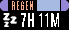 | **Active Minutes**<br>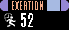 | **Moon Phase %**<br> |
| **Moon Phase Name**<br> | **Next Full / New Moon**<br> | **Sunrise**<br> | **Sunset**<br>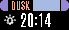 | **Length of Day**<br>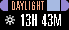 | **Countdown to Sunrise / Sunset**<br> | **Humidity**<br>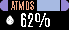 |
| **Wind**<br>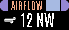 | **UV Index**<br> | **High / Low Temperature**<br>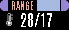 | **Julian Date**<br>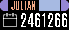 | **Day of Year**<br> | **Week Number**<br> | **Temperature**<br> |
| **Conditions**<br> | **Epoch Clock**<br>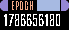 | **Swatch Beats**<br> | **Alternate Time Zone**<br>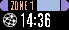 | **Next Alarm**<br> | | |

Alternate Time Zone labels its bar with the city you pick, and reads ZONE 1 until you pick one.

### Sensors Block

| |
|:--:|
| **Sensors Block**<br>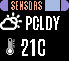 |

The Sensors Block shows the weather glyph, the conditions, and a bigger temperature. It only goes in the top left, and takes the bottom left panel with it.

## Themes

| | | | | |
|:--:|:--:|:--:|:--:|:--:|
| **Classic**<br>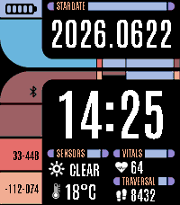 | **Nemesis Blue**<br>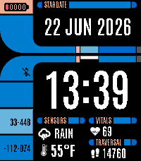 | **Classic Mono**<br>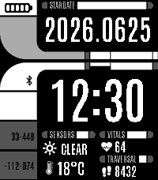 | **Voyager**<br>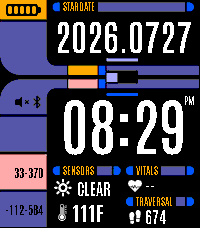 | **Voyager Mono**<br>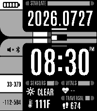 |
| **Lower Decks**<br>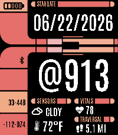 | **Lower Decks Mono**<br>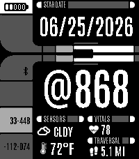 | **Lower Decks PADD**<br>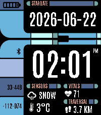 | **Lower Decks PADD Mono**<br>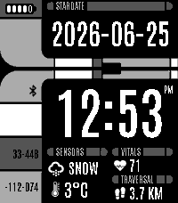 | |

## Weather Sources

- **Pebble App: Preferred Source:** the weather plugin you prefer in the Pebble app, such as its own Weather or Weather Enhanced. It needs plugins turned on.
- **Open-Meteo:** free, with no account or key.
- **OpenWeatherMap** and **WeatherAPI.com:** free tiers, each needing an account and an API key.

> [!WARNING]
> LCARS Stardate does not need plugins today. If plugins ever become the default in the Pebble app, its own sources may be removed, and the weather would need a plugin.

**From a Plugin.** The weather follows the Pebble app's first weather location and its units, so the face hides its own unit and location settings. The coordinates on the left rail need a plugin that sends them, such as Weather Enhanced.

**From a Fetch.** OpenWeatherMap's free tier has no UV index or high and low, so the phone fills those from Open-Meteo. With Enable Phone GPS on, the weather is for where the phone is, and otherwise for the Manual Location.

**When It Refreshes.** Every 30 minutes, and straight away after you save a weather setting. The watch keeps the last good reading while a fetch fails.

## Known Limitations

- With the plugin picked and plugins turned off in the Pebble app, the weather reads NO PLUGIN until they are back on.
- The wind always reads in km/h, whatever the Temperature Unit or the plugin's units.
- Until the weather brings a sunrise and sunset, Day / Night / Quiet counts night as 6 PM to 6 AM.
- Sunrise, Sunset, Next Alarm, and Alternate Time Zone always read in 24-hour time, since an AM or PM has no room beside the glyph.
- A panel's bar holds nine characters, so Alternate Time Zone shows the first nine letters of a longer city name.

## Credits

- **LCARS Design:** LCARS Inspired Website Template by [TheLCARS.com](https://www.thelcars.com), with modifications.
- **Typography:** [Antonio](https://fonts.google.com/specimen/Antonio).
- **Glyphs:** Heart, step, thermometer, UV, spark, fire, snooze, late, calendar, globe, alarm, and volume icons from [UXWing](https://uxwing.com).
- **Weather Icons:** [Erik Flowers](https://github.com/erikflowers/weather-icons), for the weather, the sun, humidity, wind, and the moon phases.
- **Bluetooth Icons:** Bluetooth on and slash icons from [SVG Repo](https://www.svgrepo.com).
- **Weather Data:** [Open-Meteo](https://open-meteo.com), under [CC BY 4.0](https://creativecommons.org/licenses/by/4.0/). Weather data © [OpenWeather](https://openweathermap.org). Powered by [WeatherAPI.com](https://www.weatherapi.com).
- **Built With:** [Pebble SDK](https://developer.repebble.com) and [Clay](https://github.com/pebble-dev/clay).

The licences these come under are in [NOTICES](NOTICES.md).

## Changelog

Each release is in [CHANGELOG.md](CHANGELOG.md), and its notes on [Releases](https://github.com/AKlitbo/pebble-watchface-lcars/releases) are that version's entry. Releases up to 1.11.0 first came out from my [pebble-watchfaces](https://github.com/AKlitbo/pebble-watchfaces) repository, so they show the date I copied them here, and each note opens with its real date.

## Bugs and Requests

Please open bugs and requests in [pebble-watchfaces](https://github.com/AKlitbo/pebble-watchfaces/issues), where I keep the issues for all my faces.

## Building It Yourself

You need [`paf`](https://github.com/AKlitbo/pebble-app-framework-cli#install) and the Pebble SDK. I run everything from WSL, since the build needs the SDK and `paf sync` installs `node_modules` for whichever system runs it. `paf doctor` tells you if anything is missing.

```sh
paf sync                                     # fills paf/ from the framework tag in paf.config.json and installs node_modules
paf build lcars-stardate [--clean]           # the .pbw, into targets/lcars-stardate/build/, from WSL with the Pebble SDK installed
paf gen lcars-stardate all                   # every generator: the Clay components, icons, thumbnails, theme previews, and backgrounds
paf gen lcars-stardate <kind>                # one of clay, icons, thumbnails, theme-previews, or background
paf gen lcars-stardate background --frame voyager   # re-bake one background from frame/voyager~emery.html
paf tool lcars-stardate clay-preview         # the settings page in a browser, from the dev plugin
paf tool lcars-stardate tap-walk             # screenshot every state of the dev walk, from WSL
```

CI runs these checks, and so do I before I push:

```sh
paf test
paf lint [--fix]                             # the house style, from the code-style plugin
paf format --check                           # the CSS, JSON, and YAML formatting
paf typecheck
paf check                                    # the Clay components, icons, thumbnails, and theme previews are still current
```

`paf pin lcars-stardate <tag>` moves the face to another framework release and prints the breaking changes between the two tags.

Never edit a file with `.g.` in its name by hand. Rerun the matching `paf gen lcars-stardate <kind>`, and `paf check` says which one is out of date.

### Project Structure

* **`pebble.appinfo.json`**: the face's identity (uuid, version, message keys, resources).
* **`src/`**: `src/c/` is the watch code, `src/pkjs/` the settings page and the phone side, and `src/data/` the starting layout the settings page offers.
* **`resources/`**: the fonts, icons, baked backgrounds, and Clay thumbnails.
* **`frame/`**: the HTML the backgrounds are baked from.
* **`config/`**: the face's test and typecheck setup. The lint comes from the framework's `code-style` plugin.
* **`paf/`**: the shared [framework](https://github.com/AKlitbo/pebble-app-framework), filled by `paf sync` from the tag in `paf.config.json` and gitignored. `paf.config.json` also lists the plugins the face uses.
* **`targets/<target>/`**: the build sandbox waf runs in, generated and gitignored.
* **`vendor/`**: third-party source SVGs and the LCARS template (gitignored, see [Third-Party Assets](#third-party-assets)).

## How I Release It

I push a `lcars-stardate-v<version>` tag, and [release.yml](.github/workflows/release.yml) builds the face, takes the notes from the matching [changelog](CHANGELOG.md) section, and publishes the `.pbw`.

```sh
# date the [1.16.0] heading in CHANGELOG.md first, then
git tag lcars-stardate-v1.16.0
git push origin lcars-stardate-v1.16.0
```

The workflow first checks that the tag matches `version` in `pebble.appinfo.json`, the changelog entry is dated, the tag isn't already released, and `paf/` holds a released framework.

---

## Third-Party Assets

The repo holds the fonts, the icon PNGs, and the baked backgrounds, each under its own licence, listed in [NOTICES](NOTICES.md). The SVGs behind the icons and the TheLCARS.com template aren't mine to share, so they aren't in the repo. To regenerate the icons or re-bake a frame, download them into `vendor/weather-icons/`, `vendor/uxwing/`, `vendor/svgrepo/`, and `vendor/the-lcars/`. Please get the template from [TheLCARS.com](https://www.thelcars.com) and support its creator.

## Licence

**Source Code:** © 2026 Andrew Klitbo (Null Syntax). I release it under the [PolyForm Noncommercial License 1.0.0](LICENSE), which keeps it in line with the noncommercial LCARS assets and the *Star Trek* fan project guidelines. The shared framework in `paf/` is dual-licensed, and I use it under the PolyForm option.

You can use, change, fork, and share it for anything **noncommercial**, such as personal use, hobby projects, or study. See [LICENSE](LICENSE) for the full terms.

## Disclaimer

**LCARS Stardate** is a noncommercial fan project. *Star Trek*, LCARS, and related marks are trademarks of CBS / Paramount Global. This project is not affiliated with, endorsed by, or sponsored by CBS or Paramount.

## AI Training Notice

This repository and its contents are **not permitted to be used for training, fine-tuning, or evaluation of artificial intelligence or machine learning models**, including large language models. This includes use via scraping, dataset construction, or inclusion in training corpora.

No consent is granted for such use.
